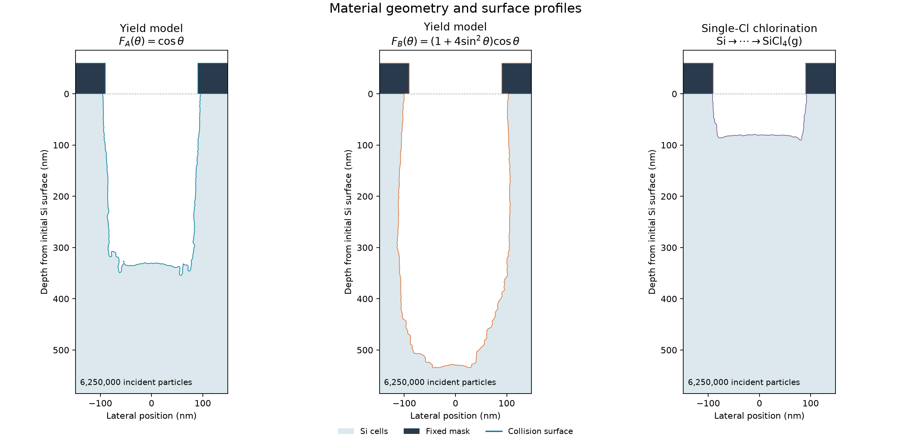

# Cl / Si 刻蚀仿真

基于蒙特卡洛粒子追踪与元胞更新的 Cl / Si 等离子体刻蚀仿真，支持二维截面和三维形貌演化，模拟粒子与表面的反应、反射及二次碰撞。



## 项目结构

```mermaid
flowchart LR
    Root["."]
    Root --> Src["src/<br/>核心仿真代码"]
    Root --> Utils["utils/<br/>构建、结果读取与绘图"]
    Root --> Tests["tests/<br/>单元测试与几何回归"]
    Root --> Outputs["outputs/<br/>仿真输出，不纳入版本控制"]

    Src --> App["app/<br/>命令行解析、维度选择与组件装配"]
    Src --> Common["common/<br/>二维与三维共用组件"]
    Src --> Planar["planar/<br/>二维截面后端，etch::planar"]
    Src --> Spatial["spatial/<br/>三维体素后端，etch::spatial"]

    Common --> Engine["engine.hpp · events.hpp<br/>逐粒子推进、运行设置与统计"]
    Common --> Reaction["reaction.hpp/.cpp · material.hpp<br/>表面反应与材料状态"]
    Common --> CellUpdate["cell_update.hpp · connectivity.hpp<br/>连通性筛选、更新提交与碎片释放"]
    Common --> CellInventory["cell_inventory.hpp<br/>四态库存守恒重映射"]
    Common --> Random["random.hpp · direction.hpp<br/>随机数、标量分布与三分量方向分布"]
    Common --> Particle["particle.hpp<br/>粒子状态与三分量碰撞法线"]
    Common --> Vector["vector.hpp<br/>空间向量与镜面反射"]
    Common --> Linear["linear.hpp<br/>最小二乘求解"]
    Common --> Traversal["traversal.hpp<br/>DDA 网格遍历与射线包围盒区间"]
    Common --> Geometry["implicit.hpp · periodic.hpp<br/>Hermite 重建、区间求根与周期判定"]
    Common --> Output["output.hpp<br/>数组与统计输出"]

    Planar --> PlanarGrid["grid.hpp/.cpp<br/>二维网格与四邻接边界"]
    Planar --> PlanarSurface["surface.hpp/.cpp<br/>局部二次曲线与连续隐式表面"]
    Planar --> PlanarTransport["transport.hpp/.cpp<br/>射线追踪与反应元胞定位"]
    Planar --> PlanarUpdate["cell_update.hpp/.cpp<br/>二维局部候选、曲线评分与缓存失效"]
    Planar --> PlanarSource["source.hpp<br/>二维源线粒子发射"]
    Planar --> PlanarVector["vector.hpp<br/>截面向量与方向投影"]
    Planar --> PlanarBackend["backend.hpp · output.cpp<br/>后端组件装配与二维几何输出"]

    Spatial --> SpatialGrid["grid.hpp/.cpp<br/>三维网格与六邻接边界"]
    Spatial --> SpatialSurface["surface.hpp/.cpp<br/>局部二次曲面与连续隐式表面"]
    Spatial --> SpatialTransport["transport.hpp/.cpp<br/>射线追踪与反应元胞定位"]
    Spatial --> SpatialUpdate["cell_update.hpp/.cpp<br/>三维局部候选、曲面评分与缓存失效"]
    Spatial --> SpatialSource["source.hpp<br/>三维源平面粒子发射"]
    Spatial --> SpatialBackend["backend.hpp · output.cpp<br/>后端组件装配与三维几何输出"]

    Utils --> Build["build.py<br/>编译与测试入口"]
    Utils --> Export["export.py<br/>ParaView 材料结构导出"]
    Utils --> Results["results.py<br/>结果读取与库存核对"]
    Utils --> Plot["plot.py · volume.py · surface.py<br/>碰撞表面、截面与体素剖视图"]

    Tests --> NumericalTests["common/<br/>插值、求根、网格遍历与包围盒检查"]
    Tests --> TrackingTests["test_tracking.cpp<br/>2D3V 一致性、反向追踪与几何缓存"]
    Tests --> PlanarTests["planar/<br/>二维核心与几何回归测试"]
    Tests --> SpatialTests["spatial/<br/>三维曲面、追踪与库存测试"]
    Tests --> ExportTests["test_export.py<br/>材料结构导出与物理坐标"]
    Tests --> CliTests["test_cli.py<br/>维度入口与输出格式测试"]
```



## 网格与状态

$x$ 为横向，$z$ 向下；三维增加 $y$。初始硅表面上方设置固定掩膜。`--cell-nm` 给出元胞边长 $h$，默认 2.5 nm；`--surface-z`、`--opening`、`--mask-thickness` 均使用元胞数，物理长度为对应数值乘以 $h$。三维 `--opening-y` 默认等于 `ny`，形成贯通沟槽，也可指定有限矩形开口。

| 状态 | 存储与含义 |
|---|---|
| `material` | `uint8`：气体 0、硅 1、掩膜 2 |
| `sites` | 每格四个 `uint16`，分别记录 Si、SiCl、SiCl₂、SiCl₃；初始有效 Si 位点数为 30 |
| `boundary`、`surface_cells` | 与气体共边的固体格；二维四邻接，三维六邻接 |
| 撞击计数 | 每格两个 `uint32`，分别累计首次和反射后撞击 |
| 横向边界 | 二维 x 周期；三维 x、y 周期 |

数组按 x 最快的顺序连续存储：二维索引为 `z * nx + x`、形状为 `(nz, nx)`；三维索引为 `(z * ny + y) * nx + x`、形状为 `(nz, ny, nx)`。`sites` 在末尾增加长度为 4 的组分轴。

## 粒子入射与碰撞

二维采用 2D3V，三维采用 3D3V：位置维度由后端确定，粒子均保存三分量单位方向和独立能量。粒子在二维源线或三维源平面上均匀发射；`--particles` 为整个源的总发射数。

发射极角 $\alpha$ 相对向下方向定义，方位角 $\varphi$ 均匀分布于 $[0,2\pi)$：

$$
\mathbf d=(\sin\alpha\cos\varphi,\sin\alpha\sin\varphi,\cos\alpha),\qquad \lVert\mathbf d\rVert=1.
$$

| 选项 | 入射方向分布 |
|---|---|
| `--angle gaussian` | 高斯立体角强度 $I(\alpha)\propto\exp[-\alpha^2/(2\sigma^2)]$，$\sigma=\mathrm{FWHM}/2.35482$ |
| `--angle cosine` | 下半球立体角密度 $\cos\alpha/\pi$ |
| `--angle normal` | 固定方向 $(0,0,1)$ |

高斯极角取 $[0,\pi/2)$，抽样密度为 $I(\alpha)\sin\alpha$。二维仅沿截面投影推进位置：

$$
\mathbf r_{xz}(s)=(x_0,z_0)+s(d_x,d_z).
$$

设 $\mathbf n$ 为从固体指向气体的单位法线。二维将截面法线扩展为 $(n_x,0,n_z)$，用完整三分量方向计算碰撞角和镜面反射：

$$
\mu=\cos\theta=-\mathbf d\cdot\mathbf n,\qquad
\mathbf d'=\mathbf d-2(\mathbf d\cdot\mathbf n)\mathbf n.
$$

投影保留原有长度；二维反射保持 $d_y$，三分量方向的总长度保持不变。`--energy constant` 使用指定单能，`--energy gaussian` 在正能量范围抽样。当前反应量由角度或氯化状态决定，反射后能量保持不变。

## 表面重建与射线追踪

在目标格周围 ±3 格收集气固边界格中心，按固体邻域质心指向目标中心的方向建立外向轴，进行二次最小二乘拟合。二维和三维的局部图函数分别为：

$$
v=f(u)=au^2+bu+c,
$$

$$
w=f(u,v)=au^2+bv^2+cuv+du+ev+f_0.
$$

定义气体侧为正的局部函数 $q_i=v-f(u)$ 或 $q_i=w-f(u,v)$，通过紧支撑单位分解合并：

$$
g=\frac{\sum_i W_iq_i}{\sum_i W_i}.
$$

$W_i$ 为各轴窗口 $(1-t^2)^4$ 的乘积，$|t|<1$；支撑半宽为拟合半径加 0.5 格，周期轴不超过半个周期。共享节点保存合并函数值、一阶及各轴混合导数；无拟合支持时，由材料标签赋予函数符号、导数取零。节点通过三次张量积 Hermite 插值形成 $C^1$ 连续函数：

$$
\Phi(\mathbf x)=0,\qquad
\mathbf n=\frac{\nabla\Phi(\mathbf x)}{\lVert\nabla\Phi(\mathbf x)\rVert}.
$$

**碰撞位置和反射法线由该重建表面确定。** `--surface-subdivisions` 控制每格沿各轴的几何细分数，默认 1；只改变重建间距 $h/\mathrm{subdivisions}$，材料格及库存保持原尺寸。

射线采用 DDA 遍历，包含经过角点、棱的接触格。射线代入 Hermite 函数后，二维得到最高六次、三维最高九次多项式；Bernstein 界排除无根区间，导数根划分单调区间，二分求根后选最近的气体进入固体交点。

反应元胞依次取：交点所在的表面格、局部支撑内法线穿过的最近表面格、中心到法线垂直距离最小的表面格；最后一种等距时比较沿法线距离。二维水平射线检查完整 x 周期，纯面外方向视为闭合投影；三维水平射线按方向浮点数的二进制表示计算 x–y 共同周期，并可由水平截面的函数界提前排除碰撞。

## 表面反应

硅表面以 $p(\theta)=\mu$ 捕获粒子，捕获后执行反应，未捕获时继续反射追踪。固定掩膜只反射。

### 产额模型 `yield`

`--angular cosine`、`--angular enhanced` 分别使用于骁图 4-5、4-6 的函数：

$$
F_A(\theta)=\cos\theta=\mu,\qquad F_B(\theta)=(1+4\sin^2\theta)\cos\theta=(5-4\mu^2)\mu.
$$

$F$ 是每次入射撞击的平均去除量。捕获事件的条件期望为 $Y=F/p$，以随机取整确定去除数：

$$
K=\lfloor Y\rfloor+\mathrm{Bernoulli}(Y-\lfloor Y\rfloor).
$$

实际去除 $\min(K,N_{\mathrm{Si,cell}})$。库存充足时，每次撞击的期望反应去除量为 $pY=F$。

### 氯化模型 `chlorination`

每个捕获粒子提供一个 Cl，在全部硅位点中等概率选择一个，将氯化程度推进一级：

$$
\mathrm{Si}\rightarrow\mathrm{SiCl}\rightarrow\mathrm{SiCl_2}
\rightarrow\mathrm{SiCl_3}\rightarrow\mathrm{SiCl_4(g)}.
$$

形成 SiCl₄ 后脱附，硅库存减一；四种固相组分保存在 `sites` 中。

## 元胞更新与局部平滑

每格初始库存为 30，反应后剩余位点数小于 5 时触发更新。更新由局部几何评分、固体连通性筛选、四态库存守恒迁移及碎片释放组成。评分沿用刘婉第 3.6.2 节的距离与角度形式；连通性约束、守恒重映射和碎片处理为本程序的数值设计。

**候选与几何评分。** 候选包括原反应格及一圈邻域内的硅表面格：二维八邻域、三维二十六邻域。候选和库存接收格限定在原格所属的局部面连通硅分支，面邻接采用二维四邻接、三维六邻接，并处理横向周期边界。

将实际碰撞点投影到原格的局部二次曲线/曲面，在投影位置计算拟合法线，以碰撞法线校准外向符号；有符号距离采用相同的方向。设候选中心连线与该外法线的夹角为 $\alpha_i$，候选中心到拟合曲线/面的最近点距离为 $d_{\mathrm{out},i}$，气体侧为正。角度使用弧度、距离使用格长，原格取 $\alpha_i=0$：

$$
S_i=0.3\alpha_i-d_{\mathrm{out},i}.
$$

二维采用曲线最近点投影，三维采用多起点 Newton 投影。局部拟合无法定义外向轴，或投影法线与碰撞法线正交时，使用碰撞点的切平面完成评分。

**连通性选择。** 对候选作虚拟删除，检查其剩余固体面邻格是否仍通过全局周期网格互相连通。先在保持连接的候选中选择最小评分；评分相同时选择位移较小者，完全等价时随机选择。若全部候选都导致断裂，按同一评分顺序推进，并处理断裂后的碎片。

**守恒迁移。** 选中邻格时，将其四态库存整体移到原格，再清空选中格。原格反应后的残余组分分配到同一局部分支内的空余位点，删除格不参与接收。设接收格当前库存为 $N_j$、容量为 $C=30$，每分配一个位点，选择接收格的概率为：

$$
P_j=\frac{C-N_j}{\sum_k(C-N_k)}.
$$

随后按残余四态组分的数量比例抽取一个状态，放入所选空位并更新容量，直到残量全部转移。四种组分的总数分别守恒，每格库存不超过 30。接收容量不足时保留反应后的库存和材料格，延后几何更新；后续碰撞继续反应，库存耗尽时即可推进。元胞更新使用独立于粒子发射和表面反应的随机流。

**碎片与缓存更新。** 固定掩膜和底部硅为锚点。完全无面邻接的孤立格，以及断裂后不再面连接到锚点的固体分量，从静态基底中释放，Si 与已结合 Cl 分别记入 `detached_si`、`detached_cl`。这部分作为固体碎片处理，飞行和再沉积未建模；仍有面连接的薄尖端按正常表面继续演化。

实际删除格和释放格附近的边界、局部拟合、反应格候选、共享节点及 Hermite 缓存同步失效；仅组分变化时复用几何缓存。`deleted_cells` 统计更新删除格数，`relocated_cells` 统计邻格库存搬移次数，`detached_cells` 统计释放格数；`redistributed_si`、`redistributed_cl` 统计残余库存转移量，`deferred_updates` 统计容量不足而延后的更新。

库存账目满足：

$$
N_{\mathrm{Si,initial}}=N_{\mathrm{Si,remaining}}+N_{\mathrm{Si,reacted}}+N_{\mathrm{Si,detached}},
$$

$$
N_{\mathrm{Cl,captured}}=N_{\mathrm{Cl,surface}}+4N_{\mathrm{SiCl_4}}+N_{\mathrm{Cl,detached}}.
$$

## 构建与使用

依赖 C++17、Python、NumPy 和 Matplotlib：

```bash
python -m pip install -r requirements.txt
python -m utils.build --geometry
python -m unittest discover -s tests -p "test_*.py"
```

通过 `--dimension 2|3` 选择二维截面或三维体素后端，默认使用二维。

将大写占位符替换为输入值：

```text
build/etch_sim.exe --dimension DIM --cell-nm H --nx NX --nz NZ --surface-z Z0 --opening W --mask-thickness H_MASK --angle gaussian --fwhm FWHM_DEG --energy-ev E_EV --model yield --angular cosine --particles N --output RUN_DIR
```

三维追加 `--ny NY`，有限矩形开口追加 `--opening-y WY`。`--reflect 0` 关闭反射；`--max-bounces` 默认 0，表示不限反射次数，可设正值做截断诊断。

```text
python -m utils.plot RUN_A RUN_B RUN_C --output comparison.png
python -m utils.volume RUN_A RUN_B RUN_C --output volume.png
python -m utils.export RUN_DIR
```

截面图的三维 y 索引默认取中间层，可用 `--slice-y` 指定。体素图去掉前半 y 区域以展示内部；导出工具生成 `RUN_DIR/structure.vti`，只含 `material` 单元标签。ParaView 坐标单位为 nm，x 原点在区域中心，z 原点在初始硅表面；二维沿 y 轴查看，Threshold 保留 1–2 可显示硅和掩膜。

## 输出与诊断

| 文件 | 内容 |
|---|---|
| `summary.json`、`arguments.txt` | 输入及运行统计；`dimension` 为位置维度，`direction_components` 为 3 |
| `material.bin`、`sites.bin` | 材料与组分数组，布局见网格与状态 |
| `surface.csv` | 局部二次拟合系数及坐标轴 |
| `surface_nodes.bin` | Hermite 节点值与混合导数，按 z、y（三维）、x、导数掩码排列；各轴节点数为格数乘细分数再加一 |
| `primary_hits.bin`、`secondary_hits.bin`、`collision_angles.csv` | 格点撞击计数及按 1° 分箱的首次撞击、二次撞击、捕获和反应去除数 |

追踪诊断包括 `interior_exits`（未碰撞而从硅片底部退出）、`mapping_failures`（交点无法定位反应格）、`normal_mapped_hits`（映射格不同于交点格）、`off_normal_mapped_hits`（法线未穿过候选格）、`max_mapping_offset_cells`（后一种情况下格中心到法线的最大垂距）和 `periodic_orbits`（无碰撞闭合周期）。`rank_deficient_fits`、`undefined_normal_fits` 分别统计拟合秩不足、质心无法定义外向轴的次数。

## 扩展

表面反应实现 `Reaction::apply(Sites&, ...)`；方向和能量由分布函数注入；位置、邻接、曲线/曲面及删格候选由后端实现，通过 `Backend` 装配到共用推进器。
