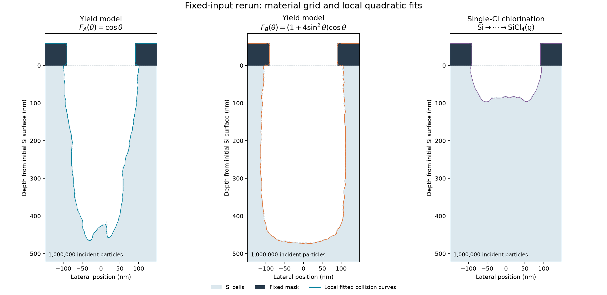
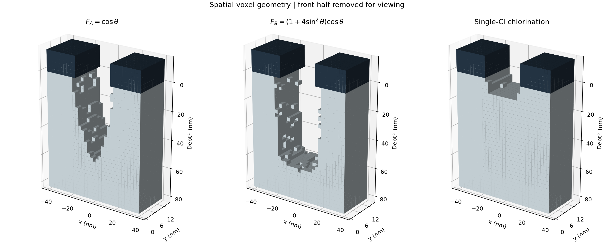
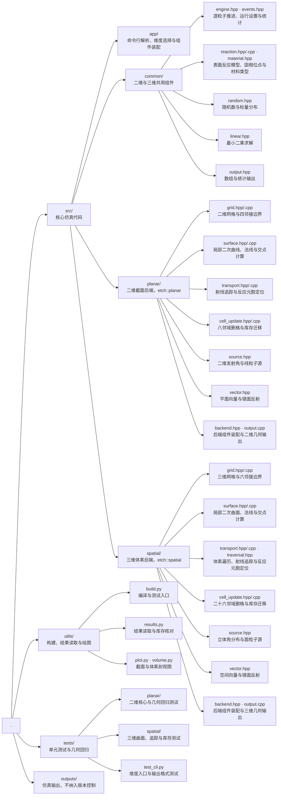

# Cl / Si 刻蚀仿真

支持二维截面和三维体素计算，通过表面捕获、反射、反应和元胞更新推进刻蚀。`--dimension 2|3` 选择几何后端，默认值为 2。两种计算共用反应模型、随机分布和逐粒子推进流程。




## 项目结构

主要目录与组件如下，连线表示目录包含关系。



## 碰撞角、捕获与表面反应

令 $\mathbf d$ 为粒子的单位运动方向，$\mathbf n$ 为碰撞点处从固体指向气体的拟合面单位法线，$\theta$ 为相对内法线的入射角：

$$
\mu=\cos\theta=-\mathbf d\cdot\mathbf n,\qquad 0\leq\theta\leq\frac{\pi}{2}.
$$

硅表面采用捕获概率 $p(\theta)=\mu$。捕获后执行所选表面反应；未捕获的粒子作镜面反射，继续追踪后续碰撞。固定掩膜表面只发生反射。

### `yield`：产额模型

`--angular cosine` 和 `--angular enhanced` 分别选择于骁论文图 4-5、4-6 中的角度函数：

$$
F_A(\theta)=\cos\theta=\mu,
$$

$$
F_B(\theta)=(1+4\sin^2\theta)\cos\theta=(5-4\mu^2)\mu.
$$

$F(\theta)$ 表示每个入射离子的平均硅原子去除数。捕获概率为 $p(\theta)$ 时，捕获事件的条件期望去除量为：

$$
Y_{\mathrm{capture}}(\theta)=\frac{F(\theta)}{p(\theta)}.
$$

对条件期望进行随机取整：

$$
K=\lfloor Y_{\mathrm{capture}}\rfloor+
\mathrm{Bernoulli}(Y_{\mathrm{capture}}-\lfloor Y_{\mathrm{capture}}\rfloor).
$$

实际去除数为 $\min(K,N_{\mathrm{Si,cell}})$。库存充足时，每次表面撞击的期望反应去除量为 $pY_{\mathrm{capture}}=F$。在 $p=\cos\theta$ 的设置下，两条角度函数对应的捕获后期望去除量分别为 $1$ 和 $1+4\sin^2\theta$。删格残量另行统计。

### `chlorination`：Cl 化反应模型

每个被捕获的粒子提供一个 Cl，在碰撞元胞的全部硅位点中等概率选择一个，将其氯化程度推进一级：

$$
\mathrm{Si}\rightarrow\mathrm{SiCl}\rightarrow\mathrm{SiCl_2}
\rightarrow\mathrm{SiCl_3}\rightarrow\mathrm{SiCl_4(g)}.
$$

形成 SiCl₄ 后脱附，硅库存减一。四种固相状态分别保存数量；该模型采用用户指定的四步反应链，`--angular` 参数用于 `yield` 模型。

## 网格与存储

| 项目 | 设置 |
|---|---|
| 网格边长 | 2.5 nm |
| 每格初始硅原子数 | 30 |
| 元胞更新条件 | 剩余硅位点数小于 5 |
| 局部拟合邻域 | 目标格周围 ±3 格 |
| 元胞删除候选邻域 | 二维八邻域；三维二十六邻域 |
| 法线推进与平滑权重比 | $m/n=0.3$ |
| 横向边界 | 二维 x 周期；三维 x、y 周期 |

网格尺度、初始库存和更新阈值采用于骁第 4.1 节的设置；元胞删除位置按刘婉第 3.6.2 节的方法选择。二维后端使用局部曲线，三维后端使用局部曲面。

$x$ 为横向坐标，$z$ 向下。初始硅表面平坦，上方是固定掩膜及其开口。网格数、掩膜尺寸、开口尺寸和入射剂量通过运行参数指定。

网格使用连续数组。二维索引为 `z * nx + x`，数组形状为 `(nz, nx)`；三维索引为 `(z * ny + y) * nx + x`，数组形状为 `(nz, ny, nx)`：

- `material`：`uint8`；0 为气体、1 为硅、2 为掩膜。
- `sites`：每格四个 `uint16`，记录 Si、SiCl、SiCl₂、SiCl₃ 的数量。
- `boundary` 与 `surface_cells`：记录与气体共边的固体元胞。
- `primary_hits`、`secondary_hits`：`uint32`，累计首次撞击和反射后的撞击。

## 元胞更新与悬挂元胞处理

当反应元胞的剩余库存小于 5 时，在该元胞及其相邻硅表面元胞中选择删除位置：二维取八邻域，三维取二十六邻域。选择同时考虑沿法线推进和减少表面凸起，以降低直接删格产生的悬挂、漂浮结构。

对每个候选元胞计算偏离局部外法线的角度 $\alpha_i$，以及中心到更新前拟合曲线的有符号法向距离 $d_i$，选择评分最小的元胞：

$$
S_i=m\alpha_i+nd_i,\qquad m/n=0.3.
$$

两种维度均以弧度计算 $\alpha_i$，$d_i$ 以元胞边长为单位；$d_i$ 在曲线固体侧为正、气体侧为负，使气体侧凸起优先参与移除。原待删除元胞的 $\alpha_i=0$，其余候选的角度由两格中心连线与外法线计算。二维通过曲线最近点计算法向距离；三维以多起点 Newton 迭代求解二次曲面的法向投影。

若选中邻格，将其四种固相库存完整转移到原待删除元胞，再删除选中格。掩膜保持固定。实际删除位置附近的边界和拟合缓存随之更新。

原待删除元胞的阈值残量分别计入 `pruned_si`、`pruned_cl`，组分转移保持 Si 和结合 Cl 数量不变。库存关系为：

$$
N_{\mathrm{Si,initial}}=N_{\mathrm{Si,remaining}}+N_{\mathrm{Si,reacted}}+N_{\mathrm{Si,pruned}}.
$$

逐步氯化模型另外满足：

$$
N_{\mathrm{Cl,captured}}=N_{\mathrm{Cl,surface}}+4N_{\mathrm{SiCl_4}}+N_{\mathrm{Cl,pruned}}.
$$

## 入射角与能量

二维粒子在源线上均匀发射，三维粒子在源平面上均匀发射。发射角相对于整体向下方向定义，碰撞角相对于局部内法线定义。`--particles` 表示整条源线或整个源平面的总发射数。

| 选项 | 二维 | 三维 |
|---|---|---|
| `--angle gaussian` | 截断到 ±90° 的角度正态分布 | 轴对称高斯立体角强度 |
| `--angle cosine` | 角度密度 $\cos\alpha/2$ | 立体角密度 $\cos\theta/\pi$ |
| `--angle normal` | 方向 $(0,1)$ | 方向 $(0,0,1)$ |

高斯参数均以 $\sigma=\mathrm{FWHM}/2.35482$ 换算。三维定义强度 $I(\theta)\propto\exp[-\theta^2/(2\sigma^2)]$，极角抽样密度包含 $\sin\theta$ 雅可比，方位角均匀分布于 $[0,2\pi)$。二维角度密度和三维立体角强度是不同的输入定义。

`--energy constant` 使用指定单能，`--energy gaussian` 在正能量范围内作高斯抽样。当前反应量由角度或氯化状态决定；粒子携带抽样能量，镜面反射后能量保持不变。

## 局部拟合与碰撞

局部外向坐标轴（二维 $v$、三维 $w$）取邻域固体元胞几何质心指向目标元胞中心的方向，按刘婉第 3.4.2 节旋转坐标。收集附近气固边界元胞的中心，作二次最小二乘拟合。二维使用：

$$
v=f(u)=au^2+bu+c.
$$

三维在两个切向轴和外向轴组成的局部坐标系中使用：

$$
w=f(u,v)=au^2+bv^2+cuv+du+ev+f_0.
$$

三维法线由两个偏导数计算：

$$
\mathbf n=\frac{\mathbf e_w-f_u\mathbf e_u-f_v\mathbf e_v}
{\lVert\mathbf e_w-f_u\mathbf e_u-f_v\mathbf e_v\rVert}.
$$

**碰撞位置和反射法线都由局部拟合决定。** 轨迹采用覆盖网格角点的 DDA 遍历；每段检索附近拟合片，在局部邻域及采样点的切向覆盖范围内选择最近的前向交点。二维求直线与曲线交点，三维将射线代入曲面得到一元二次方程。由拟合面的导数计算法线，粒子从该交点按镜面方向继续运动：

$$
\mathbf d'=\mathbf d-2(\mathbf d\cdot\mathbf n)\mathbf n.
$$

反应元胞按刘婉第 3.5 节定位：若交点所在格是表面元胞，直接使用该格；否则沿交点法线的两个方向查找局部邻域内最近的表面元胞。

拟合结果与候选表面元胞列表分别缓存。三维拟合片按表面元胞稀疏保存。元胞删除后更新受影响的拟合与候选列表；仅库存或氯化状态改变时复用几何缓存。

## 构建和测试

需要 C++17 编译器、Python、NumPy 和 Matplotlib。

```bash
python -m pip install -r requirements.txt
python -m utils.build
python -m utils.build --geometry
python -m unittest discover -s tests -p test_cli.py
```

二维保留原有参数，`--dimension 2` 可以省略。以下大写占位符替换为输入值：

```text
build/etch_sim.exe --dimension 2 --model yield --angular cosine --nx NX --nz NZ --surface-z Z0 --opening W --mask-thickness H --fwhm FWHM_DEG --energy-ev E_EV --particles N --output OUTPUT_DIR
```

三维增加 `--ny`。`--opening` 指定 x 向开口宽度；`--opening-y` 默认等于 `ny`，生成沿 y 贯通的沟槽，指定更小值则生成有限矩形开口：

```text
build/etch_sim.exe --dimension 3 --model yield --angular cosine --nx NX --ny NY --nz NZ --surface-z Z0 --opening WX --opening-y WY --mask-thickness H --fwhm FWHM_DEG --energy-ev E_EV --particles N --output OUTPUT_DIR
```

`--angular enhanced` 使用增强产额函数；`--model chlorination` 使用单 Cl 反应链。`--reflect 0` 关闭反射追踪；默认不设反射次数上限，`--max-bounces` 设置诊断用的截断次数。

绘制二维结果或三维结果的 y 向截面，三维默认取中间切片，`--slice-y` 指定切片索引：

```text
python -m utils.plot RUN_A RUN_B RUN_C --output comparison.png
```

三维体素剖视图沿 y 方向去掉前半部分，仅用于显示内部沟槽：

```text
python -m utils.volume RUN_A RUN_B RUN_C --output volume.png
```

## 输出与诊断

`summary.json`、`arguments.txt` 和原始数组保存输入、库存和轨迹统计。`dimension` 标识维度，三维额外保存 `ny`、`opening_y_cells`。`surface.csv` 在二维保存曲线系数和局部坐标轴，在三维保存曲面的六个系数及三个局部坐标轴。

- `deleted_cells`：删除的元胞数。
- `relocated_cells`：选择邻格删除并转移库存的次数。
- `pruned_si`、`pruned_cl`：阈值删格残量。
- `interior_exits`：未找到曲线碰撞却从硅片底部离开的漏检轨迹数。
- `normal_mapped_hits`：交点经过法线投影定位反应元胞的次数。
- `mapping_failures`：找到交点后无法定位反应元胞的候选次数。
- `no_local_intersections`：局部拟合没有有效前向交点的候选次数，包含反射后离开原表面的情况。
- `rank_deficient_fits`：局部拟合矩阵不满秩的次数。
- `undefined_normal_fits`：邻域质心与目标中心重合、无法定义旋转轴的拟合次数；对应元胞保留库存，暂不参与拟合面碰撞。

## 扩展

新增表面模型实现 `Reaction::apply(Sites&, ...)`，直接操作单元库存。标量能量分布放在 `common`，方向分布由各维度粒子源定义。新增几何算法在对应后端实现，通过 `Backend` 提供给共用引擎。维度分派集中在 `app`，反应模型和推进流程不包含维度判断。
